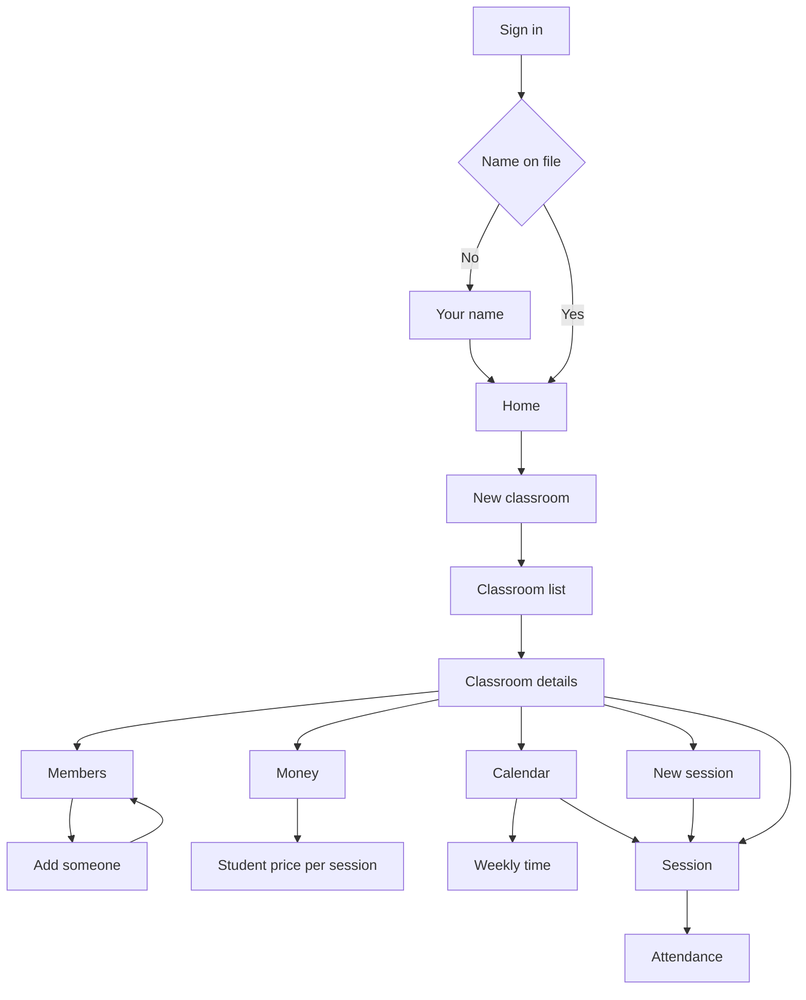

# User Flow

Drawn from `intent-statement.md`, `scope-document.md`, and `intent-backlog.md`.

One person uses this: the teacher who owns the classrooms. Laptop first. Mobile web later.

All eight flows fit the screens. Home is the Overview, and the classroom list is that same list. Classroom details are the classroom screen. Create member adds a person who already has an account. A new login is later. A payment plan is that student's price per session. A recurring schedule is the weekly time. An adhoc schedule is one new session.

<!-- Text fallback: Sign in. With no name yet, onboarding, then home. With a name, home. Create a classroom, return to the list, open its details. From details: members and add someone, a student's price, a weekly time, or one new session. Open a session and mark attendance. -->

## 1. First login

Persona: the teacher.
Trigger: the first time they sign in. No name on file yet.
Steps:
1. Sign in -> email and password -> Sign in.
2. Your name -> first and last name -> Continue.
3. Home.
Success outcome: they are on the home screen.
Error paths:
- Email or password does not match -> the form stays, with a sentence under it.
- A name is missing -> "Add both names." They stay on Your name.

## 2. General login

Persona: the teacher.
Trigger: they already have a name on file.
Steps:
1. Sign in -> email and password -> Sign in.
2. Home.
Success outcome: they are on the home screen. Onboarding does not show.
Error paths:
- Email or password does not match -> the form stays, with a sentence under it.

## 3. Create a classroom

Persona: the teacher.
Trigger: they need a new class.
Steps:
1. Home -> New classroom -> a name -> Create.
2. The classroom list. The new classroom is on it.
3. Open that row -> classroom details. Sessions, People, Calendar, and Money are on that screen.
Success outcome: the new classroom is in the list, and its details are open.
Error paths:
- The name is empty -> "Add a name." They stay on New classroom.
- Cancel -> the list, with nothing added.

## 4. Add a member

Persona: the teacher.
Trigger: a student should be in a class.
Steps:
1. Classroom list -> open a classroom.
2. People. The members are listed.
3. Add someone -> search for a person who already has an account -> choose Student -> Add.
4. People. The new member is on the list.
Success outcome: the members list shows the person just added.
Error paths:
- No one matched the search -> "No one matched that name." They stay on the search.
- They do not add anyone -> back to the same members list.

## 5. Assign a member payment plan

Persona: the teacher.
Trigger: a student in a class needs a price.
Steps:
1. Classroom details -> Money.
2. On that student's row -> Change -> the price per session -> Save.
3. Money shows that student's price.
Success outcome: the student's payment plan is the price per session on Money.
Error paths:
- The price is missing -> they stay on the change, and the old price remains.

## 6. Create a recurring schedule

Persona: the teacher.
Trigger: a class meets on the same days each week.
Steps:
1. Classroom details -> Calendar.
2. Add times, or Edit times -> the weekdays, the start, and the end -> Save.
3. Calendar shows that weekly time above the month.
Success outcome: the recurring schedule is the weekly time. It does not by itself add the session rows. Those can be generated from Tools.
Error paths:
- A day or a time is missing -> they stay on the form.

## 7. Create an adhoc schedule

Persona: the teacher.
Trigger: one class on one day, outside the weekly time.
Steps:
1. Classroom details -> New session.
2. Date, start, and end -> Create.
3. The session list shows that session. It is also on the calendar.
Success outcome: one session exists and can be opened.
Error paths:
- Date, start, or end is missing -> "Add a date, a start, and an end."
- Cancel -> the session list, with nothing added.

## 8. Take attendance

Persona: the teacher.
Trigger: a class is about to start, or has just finished.
Steps:
1. Classroom details -> Open on a session.
   Or Calendar -> click the session on its day.
2. The session lists every student.
3. Present or Absent for each student, and an optional note of what they learnt -> Save.
Success outcome: the marks and notes stay on that session.
Error paths:
- The session has no students -> the screen says so and links to People.
- Save fails -> the marks stay put, with "Attendance could not be saved." and a way to try again.

## A screen is not ready

Persona: the teacher.
Trigger: a screen is still loading, or it failed to load.
Steps:
1. Any screen after sign-in -> the Loading screen, with the sidebar still there. Sign in and Your name keep their own button label.
2. If the load fails -> Something went wrong -> Try again, or Back to overview.
Success outcome: the screen they asked for replaces Loading.
Error paths:
- A wrong field stays on its own form. It does not use Something went wrong.

## Tools

Persona: the teacher.
Trigger: they want sessions or invoices generated, away from the daily screens.
Steps:
1. Account -> Tools.
2. Generate sessions from the weekly time, or Generate invoices. Each asks before it runs.
3. Back to overview.
Success outcome: a short "Done." Tools never appear in the sidebar.
Error paths:
- It does not run -> "That did not run." and Try again. They stay on Tools.
