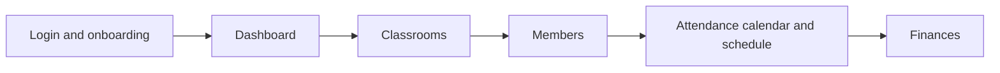

# Scope Document

Drawn from `intent-statement.md` and the answers in `scope-definition-questions.md`.

## Who it is for

The English teacher who owns this project. They are the only person who uses it for now. It might extend to other people later.

## In scope

This version is five slices, all must-have, in this order. Stop and review after each slice is finished.

1. A login page, then onboarding, then a general dashboard.
2. View classrooms, create classrooms, and view a classroom's details.
3. Classroom member management.
4. Attendance, the classroom calendar, and the schedule, as one slice. Each attendance has a short note for what the student learnt. Learning is not a separate tracker.
5. Finances, as one slice. Payment plans and invoices. The end-of-month tuition email stays later.

The screens should look good from the start, with a consistent, documented design and color palette. Most of the main classroom workflow should be usable even though the backend is not fully finished, and most of the finished backend capabilities should be available in the app.

Developer helpers stay in the app and off the main screen. That includes the helpers that generate sessions from a schedule and generate invoices. Where possible they are loosely coupled so they can be moved to another project. In the design phase the owner will say to use TanStack products, and those products' debugging tools should be integrated. That library choice is the owner's, for the design phase.

## Out of scope

- Google Meet classroom links, sending them to students, and taking attendance when someone joins. Backend, later, and only when the owner asks.
- An end-of-month email of each student's tuition.
- Profile and file storage as their own slice. Onboarding in slice 1 still covers getting into the app.

## Later, ignore for now

Checked against the API on 10 Nov 2026. The owner said these are not needed yet. Leave them, and do them in the future. They do not change the five slices above.

- The learning note has nowhere to be saved. An attendance record only says whether the student was there, away, or not yet marked. The note stays in slice 4 as a requirement. Saving it is later.
- A student can be added only by picking an account that already exists. Creating a student's login is later.
- There is no dashboard of every class at once, and sessions are listed inside one classroom. Slice 1 can still show a general dashboard. A richer cross-class view is later.
- The generate-sessions and generate-invoices helpers run only in a local developer setup. They stay the off-screen helpers. Fitting them to the real schedule, session, and invoice screens is later.
- Classroom management needs an admin login. Confirming that the owner's login has that access is later.

## Sequencing

Login and onboarding come first, because nothing else is usable without them. Classrooms come before members. Members come before attendance. The calendar and schedule travel with attendance. Finances come last. Each slice is reviewed before the next one starts.

<!-- Text fallback: Login and onboarding, then dashboard, then classrooms, then members, then attendance with calendar and schedule, then finances. Review after each. -->

## Done when

The owner is happy. There is no calendar deadline. A short note is enough when a usable slice is ready.
