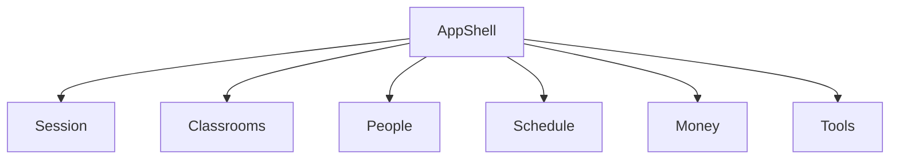

# Components

Drawn from `requirements.md`. These are the parts of the frontend to write. The generated TanStack Query functions in `src/generated` are produced from `openapi.yml` and are not a component.

```yaml
components:
  - name: AppShell
    summary: Routes, sidebar, account menu, and the shared loading and error screens.
    behaviour: >
      Mounts one feature screen at a time for a browser window 1280 CSS pixels
      wide. Sign-in and the name form have no sidebar. Every other screen uses
      the sidebar. The account menu holds Tools and Sign out. A waiting screen,
      an empty screen, and a failed screen are different. A request with no
      response for 15 seconds becomes the shared error screen, and a later
      response for that same request is ignored. Instants the server stores as
      timestamps are shown and entered as GMT+7. A session and a weekly time
      are sent as the calendar date and clock time the teacher entered.
    responsibilities:
      - Application frame, navigation, and the shared loading and error screens
      - GMT+7 display for instants
      - The account menu entry for Tools
    depends_on:
      - component: Session
        interaction: Shows sign-in and the name form, and signs the teacher out
        style: sync
      - component: Classrooms
        interaction: Shows the classroom list as home and as Classrooms
        style: sync
      - component: People
        interaction: Shows the people screen for the open classroom
        style: sync
      - component: Schedule
        interaction: Shows the overview, calendar, weekly time, and attendance
        style: sync
      - component: Money
        interaction: Shows prices and invoices for the open classroom
        style: sync
      - component: Tools
        interaction: Shows Tools from the account menu
        style: sync
    dependents: []
    external_dependencies: []
    entities: []

  - name: Session
    summary: Sign-in for the single ADMIN user, and the teacher's name.
    behaviour: >
      The only signed-in role is ADMIN. A known profile opens the classroom
      list. A missing profile asks for a first name and a last name, then opens
      the list. Email comes from the sign-in token and is not edited. Sign out,
      and any call the server rejects as signed out, returns to Sign in and
      says unsaved entries were not saved. The token is not put in a URL, shown
      on screen, or copied out of the app. This component does not grant ADMIN.
    responsibilities:
      - Sign-in, sign-out, and the name form
      - Keeping the bearer token for the generated client
    depends_on: []
    dependents:
      - component: AppShell
        interaction: AppShell shows sign-in, the name form, and Sign out
    external_dependencies:
      - name: LmsCoreApi
        kind: third-party-api
        purpose: Generated TanStack Query functions for the signed-in profile
      - name: SignInProvider
        kind: third-party-api
        purpose: Bearer sign-in for the ADMIN user
    entities:
      - name: AccountProfile
        identifier: accountId
        attributes: [firstName, lastName, email, role]

  - name: Classrooms
    summary: The classroom list, a new classroom, and a classroom's name.
    behaviour: >
      Home and Classrooms open the same list. An empty list says there are none
      and offers New classroom. Creating a classroom needs a name of 1 to 255
      characters, then returns to the list. A second click during the save does
      not create a second classroom. An empty name stays on the form and names
      the field. Two classrooms may share a name. The classroom price is stored
      on the classroom. Money edits that price through the generated client.
      This component does not call Money.
    responsibilities:
      - Classroom list, create, and rename
      - The classroom record, including its per-session price
    depends_on: []
    dependents:
      - component: AppShell
        interaction: AppShell shows the classroom list and a classroom's details
    external_dependencies:
      - name: LmsCoreApi
        kind: third-party-api
        purpose: Generated TanStack Query functions for classrooms
    entities:
      - name: Classroom
        identifier: classroomId
        attributes: [name, status, basePaymentPlanType, basePaymentPlanAmount, memberCount]

  - name: People
    summary: Students in one classroom.
    behaviour: >
      Lists active members. A removed member is not in that list. An empty list
      offers Add. Search returns accounts that already exist and does not create
      a login. Adding someone adds them as a student, at most 30 in one save.
      A person already in the class is not added again. Remove asks for
      confirmation that names the person. The teacher can open one member's
      attendance history, one page at a time.
    responsibilities:
      - Member list, add, and remove
      - One member's attendance history
    depends_on: []
    dependents:
      - component: AppShell
        interaction: AppShell shows the people screen
    external_dependencies:
      - name: LmsCoreApi
        kind: third-party-api
        purpose: Generated TanStack Query functions for accounts, members, and a member's attendances
    entities:
      - name: ClassroomMember
        identifier: classroomMemberId
        attributes: [accountId, memberRole, status, name, email]
        references:
          - entity: AccountProfile
            owned_by: Session
            relationship: each member is an account that already exists
          - entity: Classroom
            owned_by: Classrooms
            relationship: each member belongs to one classroom

  - name: Schedule
    summary: Weekly time, sessions, the calendar, and attendance for one classroom.
    behaviour: >
      The overview shows at most 10 sessions in Upcoming, Active, and Past,
      ordered by start time then session id. An empty overview offers New
      session. The calendar shows that classroom's sessions on a GMT+7 month.
      It is not a calendar of every class. A weekly time has weekdays plus a
      start and end time. Saving it does not insert session rows. Deleting it
      leaves sessions already on the list. A new session has a date, start, and
      end, and then appears on the overview and the calendar. On an open
      session the teacher marks Present or Absent. An unmarked student stays
      not yet marked. The save sends status only. A completed or cancelled
      session cannot change marks. Completing or cancelling asks for
      confirmation. There is no learning-note field. A footnote says the note
      waits until the record can store it.
    responsibilities:
      - Weekly time, sessions, calendar, and attendance
    depends_on: []
    dependents:
      - component: AppShell
        interaction: AppShell shows the overview, calendar, weekly time, and session
    external_dependencies:
      - name: LmsCoreApi
        kind: third-party-api
        purpose: Generated TanStack Query functions for schedule, sessions, and attendance
    entities:
      - name: ScheduleRecurrence
        identifier: recurrenceId
        attributes: [weekdays, startDate, endDate, startTime, endTime]
        references:
          - entity: Classroom
            owned_by: Classrooms
            relationship: each weekly time belongs to one classroom
      - name: ClassroomSession
        identifier: sessionId
        attributes: [sessionDate, startTime, endTime, status, sessionType]
        references:
          - entity: Classroom
            owned_by: Classrooms
            relationship: each session belongs to one classroom
          - entity: ScheduleRecurrence
            owned_by: Schedule
            relationship: a generated session may point at the weekly time it came from
      - name: Attendance
        identifier: attendanceId
        attributes: [status, attendanceDate]
        references:
          - entity: ClassroomSession
            owned_by: Schedule
            relationship: each attendance belongs to one session
          - entity: ClassroomMember
            owned_by: People
            relationship: each attendance belongs to one member

  - name: Money
    summary: Per-session prices and invoices, in whole VND.
    behaviour: >
      Amounts are whole VND. 0 is labeled Free. There is no other currency.
      The classroom price is per session and is saved onto the classroom. A
      student's price is per session, applies immediately, and closes the
      previous current price. A student with no current price is shown as 0
      VND. The classroom price is not copied onto that student. Money lists
      invoices the server created for the month and has no Generate button.
      New invoice needs one student and at least one line. A second click
      during the save does not create a second invoice. Approving a draft
      makes it Approved. Marking an approved invoice paid asks for the amount
      paid and Bank, Cash, or Other. The amount paid may be lower than the
      total. Cancelling a draft or an approved invoice asks for confirmation.
      A paid or cancelled invoice is not edited. An empty invoice list offers
      New invoice.
    responsibilities:
      - Classroom price edits, student prices, and invoices
    depends_on: []
    dependents:
      - component: AppShell
        interaction: AppShell shows Money for the open classroom
    external_dependencies:
      - name: LmsCoreApi
        kind: third-party-api
        purpose: Generated TanStack Query functions for prices and invoices
    entities:
      - name: MemberPaymentPlan
        identifier: paymentPlanId
        attributes: [amount, planType, effectiveFrom, effectiveTo]
        references:
          - entity: ClassroomMember
            owned_by: People
            relationship: each price belongs to one member
      - name: Invoice
        identifier: invoiceId
        attributes: [status, invoiceType, period, totalAmount, paidAmount, paymentMethod, note, lines]
        references:
          - entity: ClassroomMember
            owned_by: People
            relationship: each invoice belongs to one member

  - name: Tools
    summary: The removable session-generation helper.
    behaviour: >
      Tools is a feature folder. No other feature imports it. On a local
      developer setup, Generate sessions calls session generation from the
      weekly time. Running it again does not duplicate a session the server
      already generated for the same classroom, weekly row, and date. Off that
      setup, Tools says session generation is unavailable. Tools does not
      generate invoices.
    responsibilities:
      - Local session generation from the weekly time
    depends_on: []
    dependents:
      - component: AppShell
        interaction: AppShell opens Tools from the account menu
    external_dependencies:
      - name: LmsCoreApi
        kind: third-party-api
        purpose: Generated TanStack Query function for local session generation
    entities: []
```

## Component Diagram



<!-- Text fallback: AppShell shows Session, Classrooms, People, Schedule, Money, and Tools. Those features do not call each other. -->

## Component Summary

| Component | Purpose | Depends On | Dependents | Entities Owned |
|---|---|---|---|---|
| AppShell | Frame, navigation, loading, errors, GMT+7 | Session, Classrooms, People, Schedule, Money, Tools | None | None |
| Session | ADMIN sign-in and the teacher's name | None | AppShell | AccountProfile |
| Classrooms | Classroom list, create, and rename | None | AppShell | Classroom |
| People | Students in one classroom | None | AppShell | ClassroomMember |
| Schedule | Weekly time, sessions, calendar, attendance | None | AppShell | ScheduleRecurrence, ClassroomSession, Attendance |
| Money | Prices and invoices in VND | None | AppShell | MemberPaymentPlan, Invoice |
| Tools | Removable local session generation | None | AppShell | None |

## Entity Ownership

| Entity | Owning Component | Identifier | Attributes | References |
|---|---|---|---|---|
| AccountProfile | Session | accountId | firstName, lastName, email, role | None |
| Classroom | Classrooms | classroomId | name, status, basePaymentPlanType, basePaymentPlanAmount, memberCount | None |
| ClassroomMember | People | classroomMemberId | accountId, memberRole, status, name, email | AccountProfile, Classroom |
| ScheduleRecurrence | Schedule | recurrenceId | weekdays, startDate, endDate, startTime, endTime | Classroom |
| ClassroomSession | Schedule | sessionId | sessionDate, startTime, endTime, status, sessionType | Classroom, ScheduleRecurrence |
| Attendance | Schedule | attendanceId | status, attendanceDate | ClassroomSession, ClassroomMember |
| MemberPaymentPlan | Money | paymentPlanId | amount, planType, effectiveFrom, effectiveTo | ClassroomMember |
| Invoice | Money | invoiceId | status, invoiceType, period, totalAmount, paidAmount, paymentMethod, note, lines | ClassroomMember |

## External Dependencies

| Component | Dependency | Kind | Purpose |
|---|---|---|---|
| Session | LmsCoreApi | third-party-api | Generated TanStack Query functions for the signed-in profile |
| Session | SignInProvider | third-party-api | Bearer sign-in for the ADMIN user |
| Classrooms | LmsCoreApi | third-party-api | Generated TanStack Query functions for classrooms |
| People | LmsCoreApi | third-party-api | Generated TanStack Query functions for accounts, members, and a member's attendances |
| Schedule | LmsCoreApi | third-party-api | Generated TanStack Query functions for schedule, sessions, and attendance |
| Money | LmsCoreApi | third-party-api | Generated TanStack Query functions for prices and invoices |
| Tools | LmsCoreApi | third-party-api | Generated TanStack Query function for local session generation |

## Rationale

| Component | Why it is separate |
|---|---|
| AppShell | The frame, the shared loading and error screens, and GMT+7 change on a different cycle from any one feature. |
| Session | Sign-in and the ADMIN profile have their own lifecycle, and every other screen waits on them. |
| Classrooms | A classroom is the record the other features point at. Its list is both home and Classrooms. |
| People | Membership changes without changing the weekly time, the sessions, or the invoices. |
| Schedule | Weekly time, sessions, the calendar, and attendance are one slice and one set of records. |
| Money | Prices and invoices change on the money slice, after attendance exists. |
| Tools | Nothing else imports it. Deleting the feature and its account-menu entry removes it. |

One decomposition fits. The five slices are already the review boundaries, and Tools has to come off without taking a slice with it. A single teacher-app component would make that removal a cut through the money and schedule code.

### Alternatives Rejected

- Two parts, the teacher app and Tools. Rejected because a change to attendance would sit in the same part as invoices and sign-in.
- A gateway component that is the only caller of the backend. Rejected because each feature calls the generated functions, and a gateway would be a pass-through.
