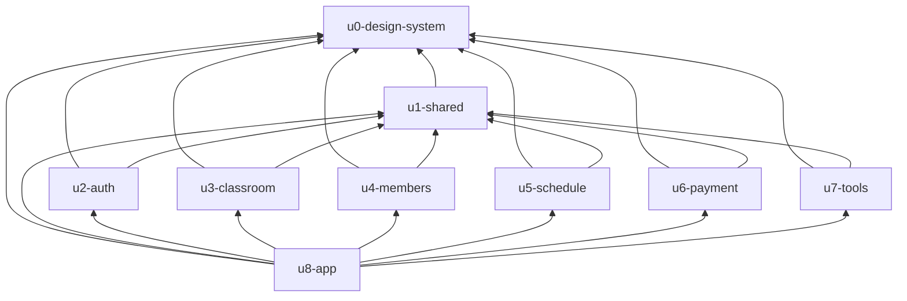

# Unit Dependencies

Topology only. This file does not choose a build order. It follows `requirements.md` and `components.md`.

A unit depends on another when its code or its tests need that unit to build and pass. Every screen unit needs `u0-design-system` for Tailwind, shadcn/ui, and the NFR3 scales. Route units also need `u1-shared` for the client, loading, errors, and GMT+7. They do not need each other's code. `u1-shared` needs the design system for its loading and error screens. `u8-app` needs the design system, `u1-shared`, and every route unit because `routeTree.gen.ts` imports every route file.

```yaml
units:
  - name: u0-design-system
    kind: library
    depends_on: []
  - name: u1-shared
    kind: library
    depends_on: [u0-design-system]
  - name: u2-auth
    kind: ui
    depends_on: [u0-design-system, u1-shared]
  - name: u3-classroom
    kind: ui
    depends_on: [u0-design-system, u1-shared]
  - name: u4-members
    kind: ui
    depends_on: [u0-design-system, u1-shared]
  - name: u5-schedule
    kind: ui
    depends_on: [u0-design-system, u1-shared]
  - name: u6-payment
    kind: ui
    depends_on: [u0-design-system, u1-shared]
  - name: u7-tools
    kind: ui
    depends_on: [u0-design-system, u1-shared]
  - name: u8-app
    kind: ui
    depends_on: [u0-design-system, u1-shared, u2-auth, u3-classroom, u4-members, u5-schedule, u6-payment, u7-tools]
```

<!-- Text fallback: u0-design-system has no dependencies. u1-shared depends on u0-design-system. u2-auth, u3-classroom, u4-members, u5-schedule, u6-payment, and u7-tools each depend on u0-design-system and u1-shared. u8-app depends on both libraries and on all six route units. No route unit depends on another route unit. -->



## How units meet

There is no call from one route unit to another. Each route unit calls the generated client in `u1-shared`. The generated route tree in `u8-app` is the only import of a route file. U3's classroom layout and U5's session routes meet only as parent and child in that tree: the layout renders an outlet, and the session routes render into it.

U8 depends on U7 because the generated tree imports the tools route. No other unit imports U7. Deleting the tools route directory and regenerating the tree removes that edge.

## Units with no edge between them

`u2-auth`, `u3-classroom`, `u4-members`, `u5-schedule`, `u6-payment`, and `u7-tools` have no edge between them. Any of them can be built at the same time. Each of those builds contains that unit, `u0-design-system`, `u1-shared`, and the project as it stands, and does not contain the other route units. `u8-app` is not in that set. Its build needs both libraries and every route unit.
